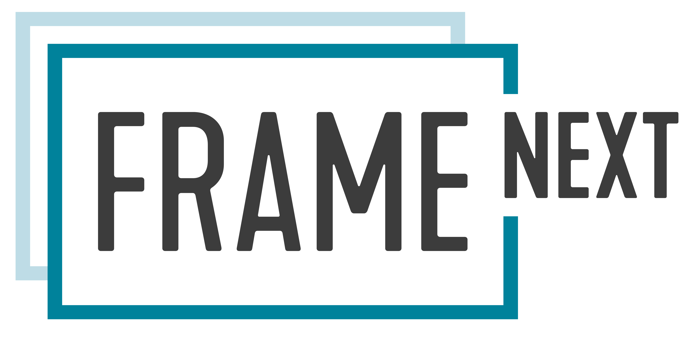

# FRAME projects

## FRAME-NEXT (completed)

FRAME-NEXT is a project that extends the European ITS Framework Architecture, in short FRAME, with the activities of the different member states in Europe, with the priority areas concerned by the ITS directive and with the methodologies and tools that make a modern ITS architecture attractive and appealing for its users. At the same time project partners from ten active EU Member States and Norway contribute their current developments and best practices and share their experiences with other stakeholders from public authorities and industry.

FRAME-NEXT is a project that extends the FRAME Architecture with the activities of the different member states in Europe, within the priority areas of the ITS directive (Directive 2010/40/EU) and with the methodologies and tools that make a modern ITS architecture attractive and appealing for its users.

FRAME-NEXT project has three main phases of work: State-of-the-Art Analysis, Evolution Cycle, and Dissemination and Outreach.

FRAME-NEXT produced version 5 of the FRAME Architecture (Enterprise Architect model with the FRAME Meta-model and the first reference architectures). Since its end the architecture is maintained by the FRAME Maintainers (see [About](../about.md)).

## Earlier projects

| Project | Result |
|---|---|
| KAREN (1998–2000) | first European ITS Framework Architecture: User Needs, functional, physical and communication architectures |
| FRAME-S, FRAME-NET (2001–2004) | support for national and regional architectures, FRAME Browsing and Selection Tools |
| E-FRAME (2008–2011) | extension with cooperative systems (version 4) |
| FRAME-NEXT (2018–2021) | version 5 in Enterprise Architect, methodology and reference architectures |

Deliverables of these projects: [Documents & Methodologies](../docs/documents-and-methodologies.md).